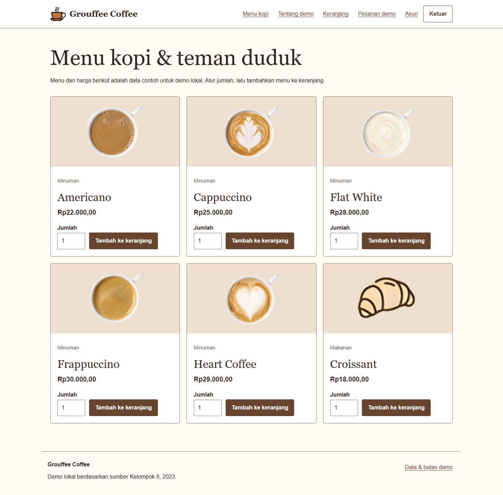
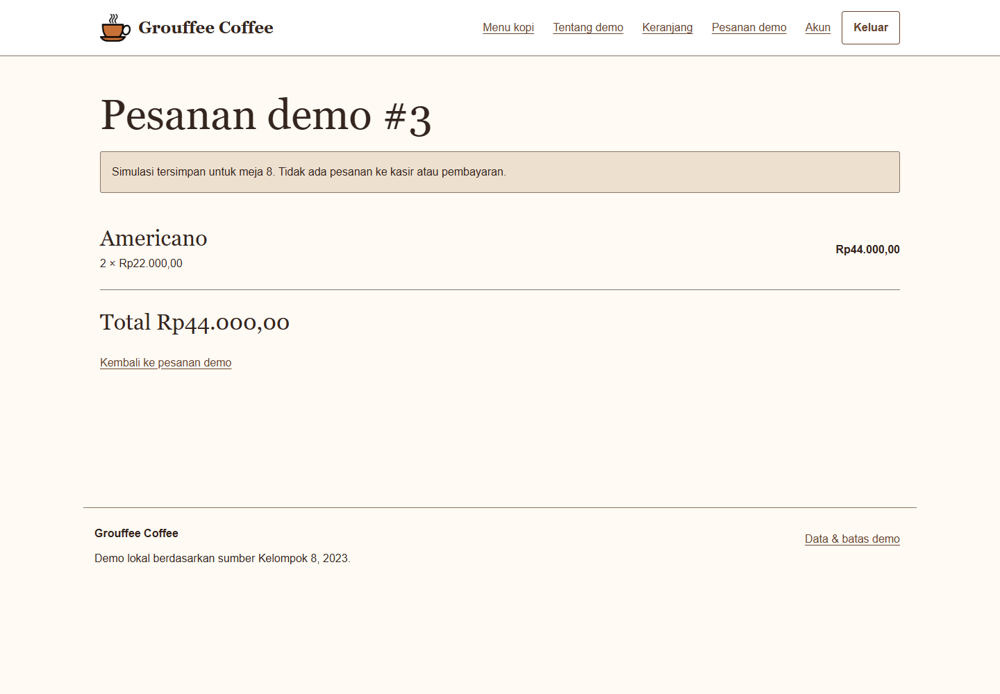

# Grouffee Coffee Java

Demo pemesanan kopi berdasarkan nomor meja dengan Java Servlet/JSP, JDBC, dan MySQL. Pengunjung membaca menu contoh; member memakai keranjang sesi dan menyimpan pesanan demo miliknya sendiri. Admin mengelola menu serta akun.

Versi ini melanjutkan proyek NetBeans **ttts** dengan nama Grouffee Coffee, warna hangat, dan gambar kopi dari sumber. Folder sumber lama tidak diubah.



*Menu sintetis pada demo lokal yang dijalankan dengan Tomcat dan MySQL.*

<details>
<summary>Lihat contoh pesanan demo yang tersimpan</summary>



*Contoh rincian pesanan milik akun demo. Tidak ada pembayaran atau pesanan ke kasir yang diproses.*

</details>

## Jalankan dengan Docker

Siapkan Docker Desktop dengan Linux containers dan Docker Compose. Cara ini tidak memerlukan Java, Maven, atau MySQL terpasang pada host. Jalankan satu demo database pada satu waktu di komputer dengan memori terbatas.

```powershell
git clone https://github.com/zalamanga/grouffee-coffee-java.git
cd grouffee-coffee-java
Copy-Item .env.example .env
```

Isi `DB_PASSWORD`, `DB_ROOT_PASSWORD`, dan `ADMIN_PASSWORD` di `.env` dengan tiga nilai berbeda. Kata sandi admin harus 12 sampai 128 karakter. `ADMIN_USERNAME` memakai 4 sampai 40 huruf, angka, atau garis bawah. Jangan commit `.env` atau memakai kredensial akun sungguhan. Di macOS/Linux, gunakan `cp .env.example .env`.

```powershell
docker compose up --build -d
docker compose ps
```

Setelah `db` dan `app` sehat, buka **http://127.0.0.1:18098**. Daftar akun member melalui antarmuka, atau masuk sebagai admin menggunakan nilai `ADMIN_USERNAME` dan `ADMIN_PASSWORD` yang kamu isi. Unduhan pertama memerlukan internet. Ubah `APP_PORT` jika port tersebut sudah terpakai.

```powershell
docker compose logs --tail 80 app
docker compose stop
docker compose start
docker compose down
```

Port aplikasi hanya dipublikasikan pada loopback; port MySQL tidak dibuka ke host. Volume `database` mempertahankan data saat container dihentikan atau `docker compose down` dijalankan. Schema dan menu contoh dibuat hanya saat volume baru pertama kali diinisialisasi. Mengubah seed SQL tidak mengubah database yang sudah ada. Mengganti password dalam `.env` juga tidak mengganti password pengguna database/admin yang sudah dibuat.

## Alur yang tersedia

| Pengguna | Tindakan |
| --- | --- |
| Pengunjung | Membaca beranda/menu, mendaftar, masuk, membaca bantuan dan penggunaan data |
| Member | Menambah/menghapus isi keranjang, mengosongkan keranjang, menyimpan pesanan demo untuk meja 1–999, membaca rincian/riwayat pesanan sendiri, mengganti kata sandi dengan kata sandi saat ini, keluar |
| Admin | Semua alur member; menambah, membaca, mengubah, dan menghapus menu serta akun dengan konfirmasi hapus |

Keranjang dibatasi 20 jenis menu dan 99 item per menu. Keranjang berakhir ketika sesi habis atau pengguna keluar. Harga di browser tidak dipercaya: saat checkout, server membaca harga menu dari database dan menyimpan snapshot nama, harga, jumlah, serta total dalam transaksi. Token checkout mencegah pengiriman formulir yang sama membentuk pesanan ganda. Rincian pesanan dibatasi berdasarkan akun yang sedang masuk; riwayat menampilkan 100 pesanan terbaru.

Checkout adalah **simulasi tersimpan**, bukan transaksi kedai. Tidak ada pembayaran, QRIS, pengelolaan stok, pengiriman, atau pesanan ke kasir. Tidak ada verifikasi email/OTP maupun pengiriman email. Jika lupa kata sandi, buat akun demo baru atau minta pengelola demo menggantinya melalui halaman admin. Email pada akun hanya data contoh.

Admin terakhir tidak dapat dihapus atau diturunkan perannya. Peran akun dibaca ulang dari database pada setiap request. Penghapusan akun menghapus pesanan demo yang terkait. Gambar menu dipilih dari aset lokal yang tersedia; aplikasi tidak menyediakan upload atau mengambil gambar dari URL luar.

## Build tanpa Docker

Siapkan **JDK 17, Maven 3.9, Tomcat 9, dan MySQL 8.4**. Bangun dari root repo:

```powershell
mvn -B -ntp clean verify
```

Hasilnya `target/grouffee-coffee-java.war`. Tes JUnit menguji hashing kata sandi, validasi identitas/input, batas keranjang, total desimal, serta perbandingan token CSRF tanpa memakai database. Dockerfile menjalankan verifikasi yang sama sebelum menyalin WAR ke Tomcat.

Untuk runtime manual, buat database `grouffee`, impor `database/schema.sql`, dan buat pengguna aplikasi yang dapat membaca/menulis database tersebut. Atur environment berikut pada proses Tomcat:

| Variabel | Isi |
| --- | --- |
| `DB_HOST`, `DB_PORT` | Default `127.0.0.1`, `3306` |
| `DB_NAME`, `DB_USER` | Default `grouffee`, `demo_app` |
| `DB_PASSWORD` | Password pengguna database aplikasi; wajib |
| `ADMIN_USERNAME`, `ADMIN_PASSWORD` | Admin bootstrap, dibuat hanya jika belum ada admin; password wajib |

Tomcat tidak membaca `.env` otomatis. Deploy WAR sebagai `ROOT.war` untuk URL tanpa context path, atau gunakan nama WAR untuk menentukan context path. Aplikasi memakai `javax.servlet`, sesuai [Servlet 4.0/JSP 2.3 pada Tomcat 9](https://tomcat.apache.org/tomcat-9.0-doc/index.html). Tomcat 10/11 memerlukan migrasi namespace Jakarta. [Panduan Connector/J dan Tomcat](https://dev.mysql.com/doc/connector-j/en/connector-j-usagenotes-tomcat.html).

## Struktur dan perubahan dari sumber

```text
database/schema.sql             schema baru dan enam menu sintetis
src/main/java/id/demo/          servlet, filter, JDBC, hashing, validasi, cart
src/main/webapp/WEB-INF/views/  JSP di balik controller
src/main/webapp/assets/         CSS, JavaScript, delapan gambar sumber
src/test/java/id/demo/          tes JUnit tanpa database
Dockerfile, compose.yaml        runtime Tomcat 9 dan MySQL 8.4
```

Login admin hardcoded, password mentah, SQL/state koneksi statis dalam JSP, harga yang dikirim browser, dan pembacaan pesanan terakhir global diganti. Versi ini memakai prepared statement, resource JDBC tertutup, PBKDF2-HMAC-SHA256 dengan salt acak dan 600.000 iterasi, token CSRF pada POST, pergantian sesi saat login, cookie HttpOnly/SameSite Lax, dan pemeriksaan peran. Password tidak ditampilkan pada daftar akun. Tidak ada migrasi otomatis akun/password/data lama. Berkas duplikat `*_1`, hasil build lama, dan konfigurasi NetBeans pribadi tidak dibawa ke repo ini.

`/health` memeriksa akses tabel menu dan mengembalikan 200 atau 503. Jika data tidak dapat dimuat, periksa kesehatan database, kecocokan konfigurasi, dan log aplikasi. Menu kosong dapat diisi admin. Jika menu yang ada di keranjang dihapus, kosongkan keranjang lalu pilih ulang.

Ini demo lokal dengan data sintetis. Untuk penggunaan publik diperlukan HTTPS/cookie Secure, pembatasan percobaan login, konfigurasi TLS database, backup/retensi, pemantauan, dan peninjauan operasional. Informasi data yang disimpan tersedia pada halaman Tentang demo.

## Atribusi

Footer sumber mencantumkan **Kelompok 8, 2023**, sementara penjelasan nama menyebut **Group Four Coffee**. Nama, arah visual, dan delapan gambar dipertahankan; perbedaan nomor kelompok dicatat tanpa menebak pembuatnya. Tidak ditemukan Git remote atau LICENSE pada sumber lokal yang diaudit. Lisensi tiap gambar belum didokumentasikan, dan repo ini tidak menambahkan klaim lisensi atau kepemilikan seluruh aset. Lihat [NOTICE](NOTICE).

## Alur kode

[Diagram alur, tanggung jawab file, dan batas penyimpanan](docs/CODE_FLOW.md).
