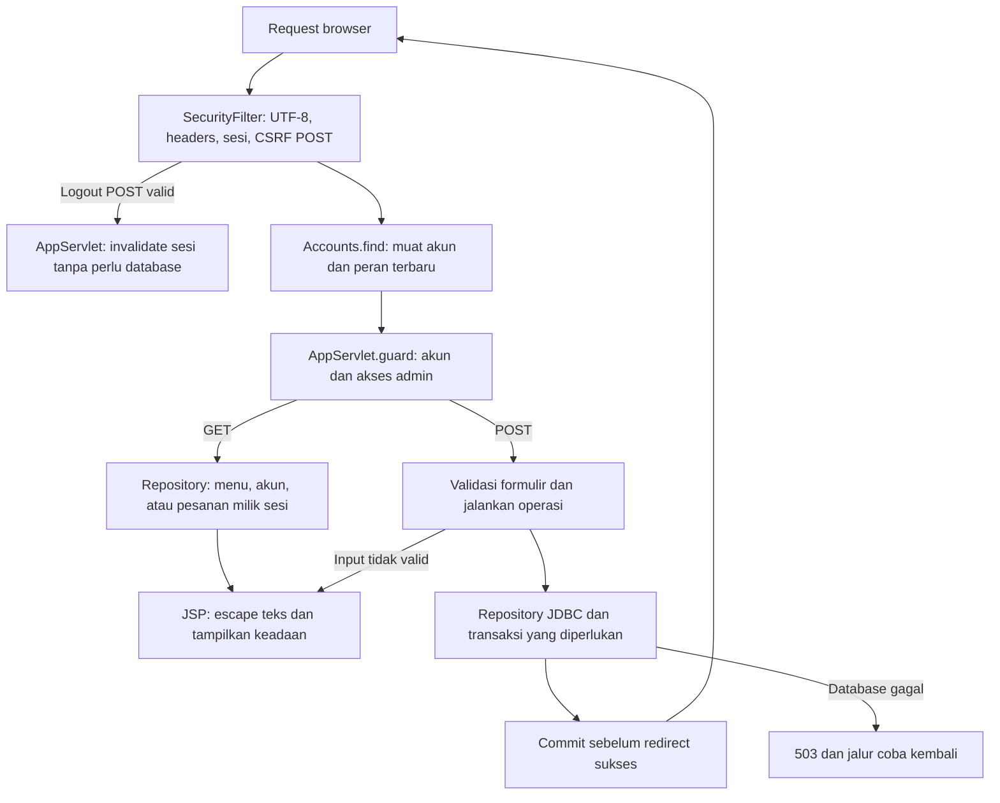
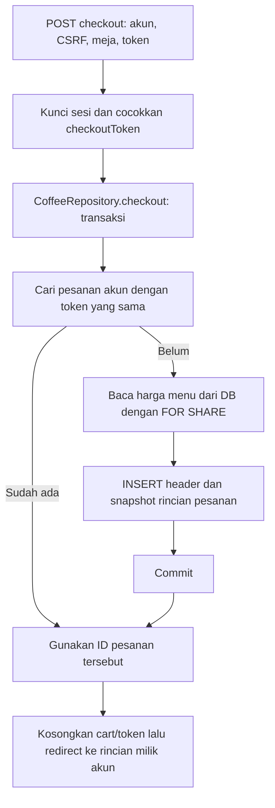

# Alur kode Grouffee Coffee

Tomcat memuat driver JDBC melalui `DriverLifecycle`, lalu `AppServlet.init` menyiapkan admin demo bila belum ada. Schema/seed MySQL dibuat Compose pada volume baru; membuka halaman tidak mereset data.

## Keranjang sampai pesanan demo

`Cart` menyimpan jumlah item dalam sesi. Tambah/hapus/kosongkan keranjang dan penghapusan token checkout berada dalam kunci `HttpSession` yang sama dengan checkout. Snapshot serta token untuk halaman keranjang ditangkap bersama; JSP memakai token request tersebut.

Harga/total dari browser tidak menjadi dasar transaksi. Pesanan dibaca dengan pasangan ID pesanan dan ID akun sesi. Admin terakhir dilindungi dengan penguncian baris akun dalam transaksi saat penghapusan atau perubahan peran.

| Bagian | Sumber |
| --- | --- |
| Registrasi/cleanup driver | [DriverLifecycle.java](../src/main/java/id/demo/DriverLifecycle.java), [Db.java](../src/main/java/id/demo/Db.java) |
| Sesi, CSRF dan pemuatan peran | [SecurityFilter.java](../src/main/java/id/demo/SecurityFilter.java) |
| Route, guard dan kunci sesi | [AppServlet.java](../src/main/java/id/demo/AppServlet.java) |
| Akun dan password | [Accounts.java](../src/main/java/id/demo/Accounts.java), [Passwords.java](../src/main/java/id/demo/Passwords.java) |
| Batas keranjang dan akses data | [Cart.java](../src/main/java/id/demo/Cart.java), [CoffeeRepository.java](../src/main/java/id/demo/CoffeeRepository.java) |
| Tampilan dan data | [app.jsp](../src/main/webapp/WEB-INF/views/app.jsp), [schema.sql](../database/schema.sql) |
| Regresi domain dan konkurensi sesi | [DomainTest.java](../src/test/java/id/demo/DomainTest.java) |

Checkout menyimpan simulasi, tanpa pembayaran atau pengiriman ke kasir. Setup, screenshot, dan batas operasional ada di [README](../README.md).
